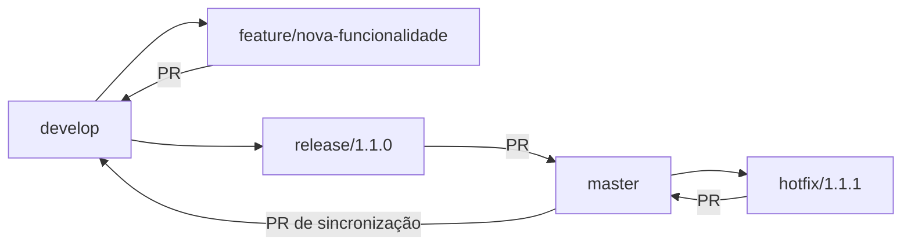

# Fluxo de desenvolvimento

Este projeto usa Git Flow com revisão por pull request. `master` guarda as versões
estáveis e `develop` integra o trabalho da próxima versão. O fluxo organiza os
commits; não publica os serviços automaticamente.



| Branch | Nasce de | Destino |
| --- | --- | --- |
| `feature/*` | `develop` | `develop` |
| `bugfix/*` | `develop` | `develop` |
| `release/*` | `develop` | `master`, depois sincronizar `master` → `develop` |
| `hotfix/*` | `master` | `master`, depois sincronizar `master` → `develop` |

`release/*` e `hotfix/*` também podem ser integradas diretamente em `develop`
quando necessário. Mantenha ambas as branches atualizadas após publicar a versão.
Não use force push nem reset para substituir o histórico compartilhado.

## Configurar um clone

Requer a extensão **git-flow AVH** instalada. A configuração fica em `.git/config`
e precisa ser feita em cada clone. Não é necessário versionar essa pasta.

```bash
git fetch origin
git switch master
git pull --ff-only origin master
git config --local gitflow.branch.master master
git config --local gitflow.branch.develop develop
git config --local gitflow.prefix.versiontag v
# Se develop já existir no remoto, crie a branch local com tracking:
# git switch --track origin/develop
git flow init -d
```

A inicialização cria `develop` localmente quando ainda não existe. Na primeira
publicação da estrutura, envie `develop` com `git push -u origin develop`.
Nos demais clones, use a `develop` remota existente para não criar uma linha
independente de desenvolvimento.

## Desenvolver uma funcionalidade

Comece com a pasta de trabalho limpa e `develop` atualizada:

```bash
git switch develop
git pull --ff-only origin develop
git flow feature start nome-da-funcionalidade
# Faça as alterações e execute os testes aplicáveis.
git status --short
git add caminho/dos/arquivos
git diff --cached --check
git diff --cached --stat
git commit -m "feat: descreve a funcionalidade"
git flow feature publish nome-da-funcionalidade
```

Abra um PR de `feature/nome-da-funcionalidade` para `develop`. Arquivos com `??`
ainda não estão no índice: confira se todos os fontes e testes necessários foram
adicionados. `git commit -am` sozinho não inclui arquivos novos.

Após aprovação e CI verde, integre pelo GitHub e atualize a `develop` local.
Use merge commit para preservar a relação entre as branches. O comando
`git flow feature finish` faz merge local; no fluxo com PR, a integração acontece
pelo GitHub. Evite executar os dois caminhos para a mesma entrega.

## Preparar uma versão

Os números abaixo são exemplos; escolha a próxima versão disponível e atualize
os manifests e respectivos lockfiles conforme os componentes alterados.

```bash
git switch develop
git pull --ff-only origin develop
git flow release start 1.1.0
# Ajuste versões, documentação e correções de estabilização.
git add caminho/dos/arquivos
git commit -m "chore: prepara versão 1.1.0"
git flow release publish 1.1.0
```

Abra um PR de `release/1.1.0` para `master`. Depois do merge aprovado, crie a tag
no commit de `master` que contém a versão e envie a tag:

```bash
git switch master
git pull --ff-only origin master
git tag -a v1.1.0 -m "Versão 1.1.0"
git push origin v1.1.0
```

Abra também um PR de `master` para `develop`, garantindo que correções e versões
retornem à linha de desenvolvimento. Apague a branch de release somente após
concluir a sincronização. Não crie tags para versões ainda em desenvolvimento.

## Corrigir uma versão publicada

```bash
git switch master
git pull --ff-only origin master
git flow hotfix start 1.1.1
# Corrija o problema, ajuste a versão e valide.
git add caminho/dos/arquivos
git commit -m "fix: descreve a correção"
git flow hotfix publish 1.1.1
```

Abra um PR de `hotfix/1.1.1` para `master`. Após aprovação, marque a versão como
no procedimento de release e abra o PR de sincronização `master` → `develop`.

## Verificações

- Backend: `docker compose exec -T backend python -m unittest discover -s tests -v`.
- Painel: na pasta `frontend`, `CI=true npx react-scripts test --watchAll=false --runInBand` e `npm run build`.
- Portal público: `CI=true npm run test:public` e `npm run build:public` na raiz.
- Patch: `git diff --cached --check`.

O workflow de CI existente constrói os serviços e executa os testes do backend.
O workflow **Git Flow / Validar destino do PR** verifica a combinação de origem
e destino dos PRs para `master` e `develop`. Os testes dos frontends devem ser
executados para alterações de interface.

No GitHub, configure regras de proteção para `master` e `develop`: exigir PR,
aprovação e os checks de CI e Git Flow; bloquear force push e exclusão dessas
branches. Essa proteção é uma configuração do repositório no GitHub, não é
ativada pela presença deste documento ou pelo workflow.

Referência: [Gitflow Workflow — Atlassian](https://www.atlassian.com/en/git/tutorials/comparing-workflows/gitflow-workflow).
