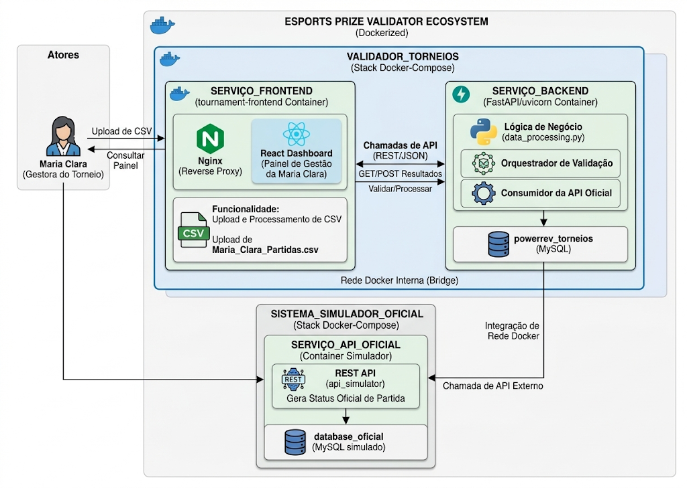

# DECISIONS.md — Registro de Decisões Arquiteturais e Trade-offs

Este documento registra as principais escolhas técnicas, alternativas consideradas, trade-offs e itens deliberadamente deixados de fora por questão de escopo e prazo, conforme solicitado no desafio da PowerRev.

---

## 1. Escolha da Stack Tecnológica

### Backend: Python (FastAPI)
* **Alternativas consideradas:** Node.js (Express/NestJS).
* **Por que foi escolhido:** A PowerRev utiliza tanto Python quanto Node.js em sua stack principal. O **FastAPI** foi escolhido pela extrema velocidade de desenvolvimento, tipagem estática integrada (Pydantic), documentação automática via Swagger e excelente suporte nativo a operações assíncronas, o que facilita enormemente a construção do simulador de latência de rede.

### Processamento de Dados: Pandas
* **Alternativas consideradas:** Leitura nativa com o módulo `csv` do Python.
* **Por que foi escolhido:** O **Pandas** oferece uma API muito mais poderosa para agrupamentos (`groupby`), somas condicionais e filtragens rápidas, garantindo que os cálculos de vitórias e rateios de prêmios por minutos ou kills sejam feitos sem código repetitivo e com alta precisão matemática.

### Banco de Dados: MySQL (via Docker)
* **Alternativas consideradas:** SQLite, PostgreSQL.
* **Por que foi escolhido:** O MySQL faz parte do ecossistema central da PowerRev. Utilizá-lo com Docker e mapear a inicialização via `docker-compose` atende perfeitamente ao requisito de subir a infraestrutura conectada de ponta a ponta com facilidade.

### Frontend: React (SPA Simples)
* **Alternativas consideradas:** Vue.js, Server-Side Rendering com Next.js, ou HTML/JS puro.
* **Por que foi escolhido:** **React** é amplamente utilizado e permite montar componentes reutilizáveis de forma muito rápida. Como o foco principal do desafio era demonstrar a engenharia de backend, o processamento de dados e a visão de produto, optou-se por uma aplicação React enxuta consumindo a API REST.

---

## 2. Decisões de Arquitetura e Regras de Negócio

### Simulação da API Oficial com Resiliência (Retries)
* **Contexto:** O desafio aponta que o site oficial possui alta latência (2 a 10 segundos) e instabilidades intermitentes.
* **Decisão:** Criou-se um simulador que introduz `time.sleep` aleatório e simula falhas controladas (15% de chance). Para garantir robustez (essencial em sistemas que lidam com dados corporativos e financeiros), implementou-se uma política interna de *retries* (tentativas repetidas) antes de registrar a falha ou divergência no relatório.

### Critério Dinâmico de Rateio de Prêmios
* **Contexto:** A Maria Clara sugeriu mudar a divisão do prêmio de **minutos jogados** para **kills dos jogadores**.
* **Decisão:** A API foi construída permitindo alternar o critério de cálculo via parâmetro (`/api/premios?criterio=minutos` ou `criterio=kills`), permitindo que a operadora avalie o impacto financeiro de ambas as regras antes de tomar a decisão de negócio definitiva.

---

## 3. O Que Foi Decidido Deixar de Fora (e por quê)

* **Autenticação e Perfis de Usuário:** Como o foco do MVP é resolver o problema operacional imediato da Maria Clara, omitiu-se um sistema completo de login/JWT por falta de tempo, focando na usabilidade direta do painel.
* **Persistência Completa de Logs de Erro no MySQL:** Embora a estrutura de banco de dados suporte o armazenamento relacional completo, optou-se por retornar os resultados da conferência diretamente via JSON na resposta da API para manter o fluxo ágil e focado na entrega do Product Engineer.