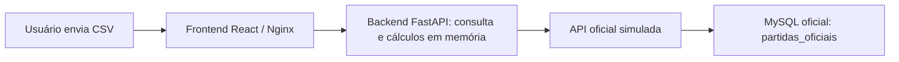

# DECISIONS.md — Registro de Decisões Arquiteturais e Trade-offs

Este documento registra decisões do desafio da PowerRev.

## Atualização: persistência de partidas

O backend agora usa MySQL para armazenar a primeira resposta oficial válida de cada ID normalizado. As consultas por CSV e por `GET /api/partidas/{match_id}` procuram primeiro no banco e só consultam a API quando não há registro. Erros não são persistidos. O volume Docker `backend_mysql_data` mantém os dados entre reinicializações. Não há expiração automática ou isolamento por usuário. Essa decisão substitui as descrições abaixo de processamento sem persistência e chamadas repetidas para IDs já consultados.

O restante do documento registra a arquitetura anterior à adição do banco.

## 1. Stack tecnológica

### Backend: Python com FastAPI

FastAPI fornece validação dos parâmetros, documentação automática e integração com o frontend React. O endpoint de consulta é síncrono e executa as chamadas HTTP à API oficial em sequência. Node.js com Express ou NestJS seria uma alternativa; Python permite usar Pandas diretamente nos cálculos.

### Processamento em memória: Pandas

Pandas lê o CSV e calcula a classificação por vitórias e o rateio por minutos ou abates. A alternativa seria combinar o módulo `csv` com agregações manuais. Os dados existem somente durante o processamento da requisição, sem persistência pelo backend.

### Frontend: React e Axios

Uma SPA permite selecionar o arquivo e o critério de rateio e visualizar partidas, jogadores, falhas e premiações na mesma tela. Axios envia o CSV como multipart. O frontend acessa `/api` pelo proxy do React em desenvolvimento e pelo Nginx nos containers.

### MySQL restrito ao simulador oficial

SQLAlchemy e PyMySQL pertencem somente à imagem do serviço externo `official-api`, que lê os dados preexistentes do seu próprio MySQL (`official-db`). O backend consulta esse serviço exclusivamente por HTTP, usando `OFFICIAL_API_URL`.

Essa separação permite executar o backend sem banco ou bibliotecas de acesso a banco. As consultas não gravam uploads, partidas, respostas ou logs no MySQL. A inicialização dos dados do simulador ocorre separadamente, pelo SQL montado no serviço `official-db`.

## 2. Arquitetura de consulta

### CSV como lista de IDs, sem vínculo com torneio

O endpoint `POST /api/upload` recebe os campos multipart `arquivo` e `criterio` (`minutos` ou `kills`). O CSV deve ser UTF-8, ter até 10 MB e conter `id_partida` ou `ID Partida`. Não há campo de nome ou ID de torneio.

Somente os IDs do arquivo orientam as consultas; as demais colunas não são comparadas nem usadas como fonte das estatísticas. Isso permite consultar partidas de diferentes torneios no mesmo envio e obter todos os jogadores retornados pela API, mesmo quando o CSV contém dados incompletos.

Os IDs são normalizados quanto a maiúsculas, espaços, caracteres invisíveis e hífens. Para IDs Fortnite, zeros extras na rodada e no número da partida também são removidos.

### Sem banco ou cache no backend

Cada envio consulta diretamente a API oficial para obter os dados das partidas solicitadas. A classificação e a premiação são calculadas em memória a partir dessas respostas.

A decisão elimina conflitos de IDs entre torneios e a necessidade de manter dados locais sincronizados. O custo é depender da disponibilidade e do tempo de resposta da API em todas as consultas; não há histórico salvo para reabrir resultados anteriores.

### Consultas sequenciais, uma por linha

Cada linha válida do CSV gera uma consulta, na ordem do arquivo. IDs repetidos também são consultados novamente. Não há deduplicação antes das chamadas, executor paralelo ou configuração de quantidade de workers.

O paralelismo foi experimentado com limites de 5, 20 e 100 consultas simultâneas. A configuração atual segue a escolha de executar uma consulta por linha sem paralelismo, mantendo a latência simulada ativa. Isso torna o processamento mais demorado: os tempos das consultas e de eventuais novas tentativas se acumulam.

O backend retorna o resultado após concluir todas as linhas. O frontend aguarda essa resposta; não há envio progressivo de partidas.

### API oficial com latência e novas tentativas

O simulador introduz atraso aleatório de 2 a 10 segundos e 5% de falhas temporárias. Os parâmetros são configuráveis por `OFFICIAL_MIN_DELAY`, `OFFICIAL_MAX_DELAY` e `OFFICIAL_FAILURE_RATE`; o arquivo `docker-compose.test.yml` mantém o atraso ativo.

O cliente HTTP usa timeout de 3 segundos para conexão e 15 segundos para leitura. Falhas de requisição podem gerar até três tentativas por linha, com esperas de 1 e 2 segundos entre elas. Uma resposta 404 é reportada como `nao_encontrada`, sem novas tentativas. Indisponibilidade e respostas inválidas são reportadas como `erro_api`.

### Resultados parciais e premiação

A resposta contém `partidas`, `falhas`, `total_solicitado`, `classificacao` e `premios`. Partidas encontradas continuam visíveis quando outras linhas falham, com os erros identificados por ID. Classificação e premiações só são calculadas quando todas as linhas terminam sem falhas.

Os cálculos usam os dados retornados pela API. Embora IDs repetidos gerem novas consultas e resultados por linha, cada partida é considerada uma única vez nos cálculos para evitar duplicar minutos, abates e premiações.

O prêmio base é de R$ 10.000,00. Os três primeiros times recebem respectivamente 50%, 30% e 20%, e o valor de cada time é dividido entre seus jogadores proporcionalmente aos minutos ou abates. O critério escolhido acompanha o upload; não depende de uma rota separada de premiações. Os valores são arredondados a duas casas decimais, sem mecanismo adicional de conciliação dos centavos residuais.

## 3. Fora do escopo atual

- **Autenticação e perfis:** o painel permanece voltado à consulta direta do MVP, sem login ou autorização por usuário.
- **Persistência, histórico e cache no backend:** foram removidos do fluxo. Resultados e falhas são devolvidos diretamente ao frontend.
- **Comparação das estatísticas do CSV com as oficiais:** o CSV fornece os IDs; a API fornece os dados usados na tela e nos cálculos.
- **Paralelismo e resultados progressivos:** o processamento atual é sequencial e retorna uma única resposta após concluir o arquivo.
