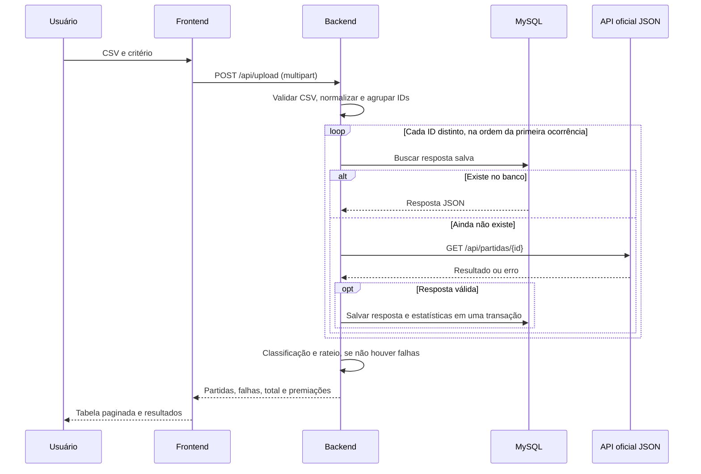

# Decisões arquiteturais e regras de negócio

Este documento descreve a implementação atual. O guia de instalação, os comandos
para outra máquina e os procedimentos de operação estão no [README.md](README.md).
As descrições antigas de backend sem persistência, banco exclusivo do simulador,
consultas por linha e falhas artificiais foram substituídas pelas decisões abaixo.

## 1. Stack e limites entre os serviços

| Componente | Implementação | Responsabilidade |
| --- | --- | --- |
| Frontend | React, Axios e CSS | Navegação, envio de CSV, filtros e apresentação |
| Backend | FastAPI, Pandas e Requests | Contratos HTTP, consulta de partidas, classificação e rateio |
| Persistência | MySQL 8 e PyMySQL | Respostas oficiais e estatísticas salvas |
| Simulador oficial | FastAPI e arquivo JSON | Fonte externa de resultados acessada por HTTP |
| Execução | Docker Compose; Nginx no frontend | Empacotamento, rede interna, proxy e persistência do volume |

Pandas concentra a leitura do CSV e as agregações. O backend consulta o simulador
por HTTP, sem importar seu arquivo JSON ou acessar um banco externo diretamente.
O simulador não tem MySQL e não usa SQLAlchemy. `requirements-official.txt` inclui
as mesmas dependências de `requirements.txt`; não acrescenta um driver específico.

O Dockerfile do backend usa Python 3.10 e tem alvos `official` e `backend`.
O frontend é construído com Node 18 e servido por Nginx. O Dockerfile faz um ajuste
explícito de AJV 8 após `npm ci --legacy-peer-deps`, devido às dependências de build
do React Scripts. A execução local deve reproduzir esse ajuste quando necessário.
As imagens-base usam tags, não um conjunto de digests fixados no repositório.

## 2. Fluxo de uma nova consulta



### Contrato do CSV

O endpoint é **`POST /api/upload`**, com `arquivo` e `criterio` (`minutos` ou `kills`).
O caminho anterior `/api/consultar-csv` não permanece como alias.

O arquivo precisa ser `.csv`, UTF-8, limitado a 10 MiB e conter `id_partida`
ou `ID Partida`. O Pandas usa o separador padrão de vírgula. Colunas adicionais
não substituem os resultados oficiais; o arquivo apenas seleciona as partidas.
Não há campo de inscrição, nome ou seleção obrigatória de torneio no upload.

### Normalização, identidade e agrupamento

`match_ids.py` normaliza Unicode, hífens, espaços, caracteres invisíveis e caixa.
A normalização adicional de zeros em rodada e partida aplica-se ao formato `FN-*`.
Ela não transforma um ID inexistente em uma partida válida da fonte.

A deduplicação acontece **após** a normalização, usando a primeira ocorrência de
cada ID. Isso evita buscas repetidas tanto para IDs encontrados quanto para erros.
O agrupamento não depende de a primeira consulta ter conseguido salvar a partida.
`total_solicitado` conta IDs distintos, e cada partida/falha aparece uma vez.

O ID externo é globalmente único no banco. A implementação pressupõe que a API
não reutilize o mesmo ID para partidas diferentes em anos ou torneios distintos.
Se essa premissa mudar, a identidade e as chaves precisarão incluir esse contexto.

### Sequenciamento e consultas HTTP

As partidas de um arquivo são resolvidas sequencialmente. Não há executor de
consultas paralelas, fila ou retorno progressivo; o frontend recebe uma resposta
ao final do processamento. Requisições HTTP independentes podem ser atendidas
concorrentemente pelo servidor, mas isso não altera a ordem dentro de um CSV.

O cliente faz uma única chamada HTTP por consulta à API oficial, sem timeout
explícito, novas tentativas ou esperas programadas. Resposta 404 é tratada como
partida ausente. Falhas HTTP/de rede são reportadas como indisponibilidade.
Sem timeout explícito, uma consulta pode permanecer aguardando a API e atrasar
as próximas partidas do arquivo.

Agrupar nove linhas do mesmo ID significa uma resolução lógica daquele ID,
com no máximo uma chamada HTTP, caso a partida ainda não esteja no banco.

### Resultados parciais

A resposta contém `partidas`, `falhas`, `total_solicitado`, `classificacao` e `premios`.
Partidas válidas são persistidas mesmo se outras falharem. Nessa situação, não há
classificação ou rateio do envio: os campos ficam `[]` e `null`, respectivamente.
A interface mostra as partidas encontradas e identifica cada falha pelo ID.

O upload pode retornar HTTP 200 com falhas por ID. Validação do arquivo, parâmetros
HTTP e indisponibilidade do banco têm respostas de erro próprias. A consulta
individual `GET /api/partidas/{match_id}` usa o mesmo fluxo banco → API → gravação,
com 404 para partida ausente e 502 para falha da API oficial.

## 3. Persistência e inicialização

### MySQL pertence ao backend

O backend salva tanto a resposta JSON completa quanto as estatísticas relacionais:

| Tabela | Conteúdo |
| --- | --- |
| `equipes` | Nomes dos times |
| `jogadores` | Jogadores vinculados aos times |
| `partidas` | ID externo único, data e rodada |
| `estatisticas_partida` | Minutos, kills e vitória de cada jogador na partida |
| `respostas_oficiais` | Payload JSON completo, identificado pelo ID externo |

A gravação da partida, das estatísticas e da resposta é uma única transação,
com rollback para erros MySQL tratados. Os relacionamentos com exclusão em cascata
mantêm os registros dependentes vinculados à partida. Consultas de respostas por
ID aproveitam a chave primária de `respostas_oficiais`; `partidas.id_partida_externo`
e `equipes.nome` também são únicos. O código não cria índices adicionais de busca
textual ou de agregação anual.

A coluna relacional `data_partida` armazena uma data (`DATE`). O payload JSON
preserva a data/hora original da API, incluindo `tournamentId`, mortes e assistências.

### Criação no startup

O MySQL do Compose cria o banco e o usuário no primeiro uso de um volume vazio.
O `lifespan` de FastAPI chama `database/initialization.py` antes de disponibilizar
as rotas. Essa função executa `CREATE TABLE IF NOT EXISTS` do `schema.sql` uma
vez por inicialização de processo. `conectar()` apenas abre a conexão PyMySQL.

Se o banco estiver indisponível ou a criação falhar, o backend não conclui o startup.
O healthcheck do MySQL executa `SELECT 1` por TCP com o usuário e banco da
aplicação. Isso evita considerar saudável o servidor temporário de inicialização
do MySQL, que pode responder por socket antes de aceitar conexões TCP. Os
healthchecks e `depends_on` do Compose organizam a ordem: banco e simulador
saudáveis antes do backend; backend saudável antes do frontend.

Esse mecanismo cria tabelas ausentes, mas **não migra estruturas existentes**.
Alterações futuras de colunas e índices exigem uma migração explícita. A aplicação
abre conexões por operação e não implementa um pool de conexões próprio.

### Reutilização e durabilidade

O caminho normal salva a primeira resposta válida de cada ID. Consultas posteriores
retornam o JSON salvo sem atualizar a API, expirar o registro ou invalidar o cache.
Falhas e respostas rejeitadas não são persistidas. Uma atualização no JSON do
simulador não modifica uma partida que já esteja no banco.

O CSV original, o nome do arquivo, o critério escolhido e o evento de upload não
são armazenados como um histórico de requisições. O volume `backend_mysql_data`
preserva as tabelas entre recriações de containers. Clonar o Git em outra máquina
não copia esse volume; o README descreve dump e restauração quando necessários.

## 4. Histórico de partidas

`GET /api/historico` acessa somente o banco. O frontend envia `limit`, `offset` e
`busca`. A consulta procura o texto no ID externo ou em `resposta.confronto`,
extraído do JSON. Os valores são passados como parâmetros ao driver.

A busca usa `LIKE '%texto%'`, sem índice especializado ou mecanismo de busca
externo. Uma consulta `COUNT(*)` fornece o total; outra retorna a página com
`LIMIT` e `OFFSET`. A ordenação por `partidas.id DESC` representa a inserção mais
recente, não a data da partida nem a última vez em que alguém a consultou.

Cada ID aparece uma vez. A tela não representa sessões anteriores de upload e
não dispara novas consultas à API oficial. O campo `origem` permanece no contrato
HTTP para indicar `api` ou `banco`, mas sua coluna foi removida da tabela visual.

## 5. Classificação, empate e rateio

`TournamentService` centraliza as regras usadas tanto pelo upload quanto pela
consulta anual. Não há uma segunda implementação dessas regras no frontend.

### Ordem de classificação

1. Número de vitórias, contando partidas distintas por time.
2. Total de kills dos jogadores daquele time nas partidas consideradas, incluindo
   as derrotas, como desempate.
3. Se os dois valores empatarem, os times compartilham a colocação. A ordem
   alfabética estabiliza a exibição sem criar um vencedor adicional.

A numeração salta posições ocupadas pelo empate: duas equipes em 1º são seguidas
pela equipe em 3º. A classificação anual inclui times sem vitórias; a distribuição
de prêmios considera somente times com pelo menos uma vitória.

### Prêmio por time e jogador

O prêmio base é R$ 10.000,00. As posições premiadas recebem 50%, 30% e 20%.
Para um empate completo, somam-se as parcelas das posições ocupadas e divide-se
pelo número de times empatados. Posições além da terceira contribuem com zero.

| Empate | Parcela de cada time |
| --- | --- |
| 1º e 2º | `(50% + 30%) / 2 = 40%` |
| 2º e 3º | `(30% + 20%) / 2 = 25%` |
| 3º e 4º | `(20% + 0%) / 2 = 10%` |

Dentro do time:

```text
prêmio do jogador = prêmio do time × (total do jogador / total do time)
```

O total é a soma dos minutos ou dos kills, conforme a estratégia escolhida.
Alterar o critério muda as parcelas dos jogadores, não o vencedor do torneio.
Se o total for zero, os pagamentos desse time ficam em zero. Parcelas de posições
sem times elegíveis não são redistribuídas.

Os cálculos usam ponto flutuante e arredondamento de duas casas na saída. Não há
ajuste de centavos residuais; a soma dos valores exibidos pode diferir por centavos
do valor atribuído ao time. Não existe pagamento financeiro integrado.

### Extensão dos critérios: princípio Aberto/Fechado

`CriterioRateio` define `calcular_totais(dados)`, retornando uma Series do Pandas
indexada pelo jogador. `RateioPorMinutos` e `RateioPorKills` implementam esse
contrato. O serviço recebe um registro de estratégias por injeção no construtor:

```python
service = TournamentService(criterios={'novo': MeuCriterio()})
resultado = service.calcular_rateio_premios(dados, criterio='novo')
```

Adicionar uma estratégia não exige modificar a função de distribuição. Para
oferecer o novo critério no produto, também é necessário registrá-lo na composição
do serviço, liberar o valor na validação HTTP e acrescentá-lo à seleção da interface.
Atualmente o contrato público aceita apenas `minutos` e `kills`.

## 6. Ganhadores por ano e torneio

`GET /api/ganhadores` lê as respostas persistidas, remove duplicidade por ID externo
e agrupa por ano da data oficial e `tournamentId`. Não consulta a API externa.
Na ausência de `tournamentId`, o grupo é identificado como `sem-identificacao`.

O endpoint retorna anos disponíveis, torneios do ano selecionado, total de
partidas, ganhadores, classificação e rateio. Sem seleção explícita, usa o ano
mais recente e o primeiro torneio em ordem alfabética. Um ano/torneio solicitado
sem partidas retorna um resultado vazio, sem misturar dados de outro grupo.

O serviço carrega todas as respostas salvas para formar esses grupos. A página
aberta no Histórico não limita o cálculo. Para volumes maiores, essa leitura
completa e as agregações em memória poderão ser substituídas por filtros e
agregações no banco; isso ainda não está implementado.

Um empate completo na liderança retorna todos os ganhadores daquela posição.
Os jogadores são apresentados em ordem decrescente de prêmio. A aba descreve
os dados disponíveis, não certifica que o torneio terminou ou que todas as suas
partidas foram consultadas.

A Nova consulta mantém uma diferença deliberada: seu rateio usa o conjunto de
IDs enviado, mesmo se contiver vários torneios. A aba Ganhadores isola ano/torneio.

## 7. API oficial simulada por JSON

O arquivo `Partidas_oficiais.json` é a fonte externa de teste. Contém uma lista de
partidas com `matchId`, `matchDate`, `round`, `tournamentId`, `teamA`, `teamB` e
`winnerTeam`. Os participantes incluem `nickname`, `minutesPlayed`, `kills`,
`deaths` e `assists`.

O servidor adapta esses campos ao contrato consumido pelo backend. Em especial,
`minutesPlayed` vira `minutos` e `matchDate` vira `data_partida`. Cada requisição
relê o arquivo. IDs duplicados após normalização ou erros de leitura/estrutura
tratados produzem HTTP 503; ID não encontrado produz HTTP 404.

Não há delays artificiais ou falhas aleatórias. `tempo_resposta_segundos` mede
o processamento real do endpoint. O arquivo está montado em modo somente leitura
no Compose; o caminho pode ser configurado com `OFFICIAL_DATA_PATH` ao executar
o simulador diretamente. A alteração do mount em Docker exige ajustar o Compose.

## 8. Interface, estado e paginação

A aplicação React usa navegação horizontal com Sobre o site, Histórico,
Ganhadores e Nova consulta. O layout e os componentes de tabela, paginação e
premiação são compartilhados, com estilos responsivos e foco visível.

Hooks separados cuidam de upload, histórico e ganhadores. As requisições usam
`AbortController`; respostas canceladas não atualizam o estado. O formulário e
os resultados da Nova consulta permanecem ao navegar entre abas, mas não após
recarregar a página. A durabilidade das partidas depende do banco, não do estado React.

A paginação de 5, 10 ou 20 partidas é feita no frontend para o resultado de um
upload e no backend para o Histórico. Os jogadores são abertos dentro da linha
da partida. As tabelas de classificação anual e de prêmios mostram o conjunto
calculado para a seleção atual, sem paginação de partidas.

O frontend não replica as regras de dinheiro ou desempate: envia o critério e
renderiza o resultado do backend. O navegador usa `/api` na mesma origem,
encaminhado pelo proxy React no desenvolvimento ou pelo Nginx no Docker.

## 9. Verificação e limites atuais

As suítes Python e React cobrem os fluxos e as regras de negócio, com mocks para
não depender de banco/API nos testes comuns. Um teste opcional usa MySQL real
para verificar persistência entre processos e deve apontar para um banco dedicado,
pois a preparação limpa as partidas desse banco.

O módulo `verification_service.py` e seus testes de comparação CSV/oficial são
um fluxo legado, sem rota nas APIs atuais. A existência desse código não significa
que estatísticas do CSV sejam comparadas durante o upload.

Ainda não são implementados:

- Login, autorização ou isolamento do histórico por pessoa.
- Histórico de eventos de upload, critérios escolhidos ou alterações de resultados.
- Expiração, atualização automática ou sincronização das respostas já salvas.
- Migrações de schema e pool de conexões próprio.
- Paralelismo dentro do arquivo, processamento em fila ou resultados progressivos.
- Catálogo independente de torneios, calendário e confirmação de encerramento.
- Cache de classificações anuais, conciliação de centavos ou pagamentos.

O Compose fornece um ambiente de desenvolvimento e demonstração com credenciais
padrão. A instalação em outra máquina pode começar com banco vazio; os dados do
simulador ficam no Git e os dados das consultas ficam no volume MySQL.
