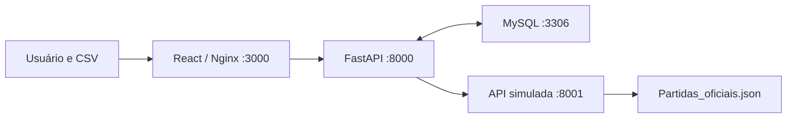

# Tournament Hub — PowerRev Tech Challenge

Painel para consultar partidas a partir de um CSV, guardar os resultados em
MySQL e calcular classificação e premiações por minutos jogados ou abates.
O frontend tem quatro abas: **Sobre o site**, **Histórico**, **Ganhadores** e
**Nova consulta**.

A tela inicial permite **criar conta** e **entrar** com login e senha. O cadastro
solicita nome, login, senha e empresa. O painel e as APIs de partidas exigem
uma sessão válida. O histórico permanece compartilhado entre as contas.

### Autenticação

O backend cria automaticamente as tabelas `usuarios`, `sessoes_usuario` e
`tentativas_autenticacao` ao iniciar, sem apagar as tabelas ou partidas existentes.
O login é único e normalizado para minúsculas. Aceita de 3 a 100 caracteres:
letras ASCII, números, ponto, `_`, `@`, `+` e hífen. Nome e empresa são obrigatórios,
com até 150 caracteres. A senha deve ter entre 12 e 128 caracteres e é armazenada
como PBKDF2-HMAC-SHA256, com salt aleatório e 600.000 iterações, conforme
a [referência OWASP para esse algoritmo](https://cheatsheetseries.owasp.org/cheatsheets/Password_Storage_Cheat_Sheet.html).

| Método e caminho | Uso |
| --- | --- |
| `POST /api/auth/cadastro` | JSON com `nome`, `login`, `senha`, `empresa`. Cria conta e sessão. |
| `POST /api/auth/login` | JSON com `login`, `senha`. Cria sessão e substitui a sessão atual. |
| `GET /api/auth/me` | Retorna `id`, `nome`, `login`, `empresa` da sessão. |
| `POST /api/auth/logout` | Revoga a sessão no banco e remove o cookie. |
| `POST /api/auth/perfil` | Atualiza `nome`, `login` e `empresa` do usuário autenticado. |
| `POST /api/auth/senha` | Recebe `senha_atual` e `nova_senha`. Altera a senha e encerra as outras sessões. |

Após entrar, clique no nome do usuário no cabeçalho para abrir **Editar informações**,
**Trocar senha** ou **Sair da conta**. As telas de conta permitem atualizar nome, login
e empresa, ou trocar a senha informando a senha atual e confirmando a nova senha.
O novo login passa a valer no próximo acesso. A troca de senha mantém a sessão atual
e revoga todas as outras sessões em uma única transação.

A sessão dura 8 horas, fica em cookie `HttpOnly`, `SameSite=Lax`, caminho `/api`,
e apenas o hash do token fica no banco. Ao recarregar a página, o frontend consulta
`/api/auth/me`. Sessões vencidas exigem novo login. **Sair da conta** revoga o token
no servidor. Senhas e hashes não aparecem nas respostas da API, inclusive nos erros
de validação.

As requisições POST exigem o cabeçalho `X-Requested-With: TournamentHub`.
O frontend o envia automaticamente. Origens de navegador precisam estar na lista
`CORS_ORIGINS`; a proteção também vale para uploads. Scripts e clientes HTTP devem
enviar esse cabeçalho e preservar os cookies entre as chamadas. O Swagger apresenta
o campo desse cabeçalho nas rotas protegidas. Para usá-lo diretamente pelo navegador,
inclua também a origem do Swagger em `CORS_ORIGINS`.

Cadastro, login e troca de senha compartilham um limite de 20 requisições a cada 15 minutos por IP,
persistido no MySQL. Atrás de proxy, clientes que compartilham o mesmo endereço
percebido pelo backend também compartilham esse limite. O backend não confia em
cabeçalhos de IP enviados pelo cliente. Respostas: `401` para credenciais ou sessão
inválidas, `403` para falha na proteção da requisição, `409` para login duplicado,
`422` para campos inválidos, `429` para excesso de tentativas e `503` para banco
indisponível.

Em produção com HTTPS, configure `AUTH_COOKIE_SECURE=true` e `CORS_ORIGINS` com
a origem pública exata. Em desenvolvimento HTTP local, o padrão é `false`.
As contas têm o mesmo acesso ao histórico; o campo empresa é informativo e não
implementa separação de dados por organização.

Para validar o fluxo real com Docker, criando e removendo somente uma conta
temporária de teste:

```bash
docker compose exec -e AUTH_TEST_BASE_URL=http://frontend backend python -m unittest discover -s tests -p 'test_auth_integration.py' -v
```

## 1. Rodar em outra máquina com Docker

Este é o caminho recomendado. Não é necessário instalar Python, Node.js ou
MySQL na máquina: os quatro serviços são executados em containers.

### Pré-requisitos

- Git e acesso ao repositório.
- Docker Engine com Compose v2 ou Docker Desktop iniciado, com containers Linux.
- Internet no primeiro build, para baixar imagens e dependências.
- Portas `3000`, `8000`, `8001` e `3306` disponíveis.

No Windows, use Docker Desktop com WSL2. Os exemplos de comandos de shell
mais adiante usam Bash, disponível no Linux, macOS e WSL2.

### Baixar e iniciar

```bash
git clone https://github.com/mikasa42/esports-prize-validator.git
cd esports-prize-validator
docker --version
docker compose version
docker compose up -d --build --wait --wait-timeout 180
docker compose ps
```

Se o repositório exigir autenticação, use uma conta com acesso. Se já tiver
uma cópia, execute os comandos Docker na raiz dela, onde está `docker-compose.yml`.

O primeiro build e a inicialização do MySQL podem demorar. Os serviços
`backend-db`, `official-api` e `backend` devem ficar `healthy`; o `frontend`
deve ficar em execução. Se o tempo de espera acabar, confira os logs antes
de repetir o comando.

| Serviço | Endereço na máquina |
| --- | --- |
| Frontend | http://localhost:3000 |
| Swagger do backend | http://localhost:8000/docs |
| ReDoc do backend | http://localhost:8000/redoc |
| Esquema OpenAPI do backend | http://localhost:8000/openapi.json |
| Swagger do simulador oficial | http://localhost:8001/docs |
| MySQL do backend | `127.0.0.1:3306` |

Não é necessário executar SQL manualmente. O MySQL cria o banco e o usuário
no primeiro uso do volume. O healthcheck do MySQL verifica uma conexão TCP
autenticada com o usuário da aplicação antes de liberar o backend. Ao iniciar,
o backend executa
`backend/src/database/schema.sql` uma vez por processo para criar as tabelas
que ainda não existem. O simulador lê o JSON que já acompanha o repositório.

### Primeiro teste pela interface

1. Abra http://localhost:3000, clique em **Criar minha conta**, preencha os dados e entre em **Nova consulta**.
2. Clique em **Baixar CSV de exemplo** ou crie `partidas.csv` com este conteúdo:

   ```csv
   id_partida
   MATCH-1001
   MATCH-1002
   MATCH-1001
   ```

3. Selecione ou arraste o arquivo, escolha **Minutos jogados** ou **Abates**
   e clique em **Consultar partidas**.
4. O resultado deve mostrar **2 de 2 partidas encontradas**. O ID repetido
   conta uma vez. Use **Ver jogadores** para abrir as estatísticas.
5. Acesse **Histórico** para encontrar as duas partidas salvas. A busca aceita
   um ID, como `MATCH-1001`, ou parte do confronto, como `FURIA`.
6. Acesse **Ganhadores**, selecione o ano `2026`, o torneio `tournament-55` e
   altere o critério para conferir o rateio dos jogadores.

Em uma instalação nova, Histórico e Ganhadores começam vazios. O JSON não é
importado integralmente para o banco: cada partida é salva quando consultada.
O ganhador considera somente as partidas que já estão no histórico.

### Conferir pela API

Na raiz do projeto, com o `partidas.csv` do exemplo salvo:

```bash
curl --fail http://localhost:8000/
curl --fail http://localhost:8001/health
# Use o login de uma conta criada pela interface. A senha é lida sem eco.
read -r -p 'Login: ' tournament_login
read -r -s -p 'Senha: ' tournament_password
export tournament_login tournament_password
python3 -c 'import json, os; print(json.dumps({"login": os.environ["tournament_login"], "senha": os.environ["tournament_password"]}))' | curl --fail -c /tmp/tournament-cookies.txt -H 'Content-Type: application/json' -H 'X-Requested-With: TournamentHub' --data-binary @- http://localhost:3000/api/auth/login
unset tournament_login tournament_password
curl --fail -b /tmp/tournament-cookies.txt -H 'X-Requested-With: TournamentHub' -F 'arquivo=@partidas.csv' -F 'criterio=kills' http://localhost:3000/api/upload
curl --fail -b /tmp/tournament-cookies.txt 'http://localhost:3000/api/historico?limit=5&offset=0&busca=FURIA'
curl --fail -b /tmp/tournament-cookies.txt 'http://localhost:3000/api/ganhadores?ano=2026&torneio=tournament-55&criterio=minutos'
curl --fail -b /tmp/tournament-cookies.txt -H 'X-Requested-With: TournamentHub' -X POST http://localhost:3000/api/auth/logout
```

O upload também pode ser feito pelo Swagger, em **POST /api/upload → Try it out**.

### Parar, voltar e atualizar

```bash
# Para os containers e mantém o histórico no volume.
docker compose down

# Volta a executar com o mesmo histórico.
docker compose up -d --wait --wait-timeout 180

# Depois de atualizar os arquivos do projeto, reconstrói as imagens.
docker compose up -d --build --wait --wait-timeout 180

# Diagnóstico.
docker compose ps
docker compose logs --tail=100 backend official-api backend-db frontend
```

O volume `backend_mysql_data` guarda as partidas entre reinicializações.
`docker compose down -v` também remove esse volume e **apaga o histórico**.
Um clone em outra máquina não leva os dados desse volume; para levá-los, use
o procedimento de backup e restauração ao final deste documento.

## 2. Fluxos e regras atuais

### Nova consulta

O CSV deve ser UTF-8, ter no máximo 10 MiB e possuir a coluna `id_partida`
ou `ID Partida`. São aceitos vírgula, ponto e vírgula ou tabulação como separadores;
cada linha precisa de um ID preenchido. Colunas e linhas são preservadas na
conferência CSV × API. Classificação e premiações usam exclusivamente os dados oficiais.
Você pode misturar IDs de torneios e anos diferentes no mesmo arquivo.

O backend normaliza os IDs: maiúsculas, espaços, caracteres invisíveis e
variantes de hífen. Por exemplo, ` match–1001 ` vira `MATCH-1001`. A remoção
de zeros extras existe especificamente para IDs no formato `FN-2026-R01-M01001`,
normalizados para `FN-2026-R1-M1001`; isso não cria IDs ausentes no JSON.

Depois da normalização, os IDs são agrupados na ordem da primeira ocorrência.
Nove linhas com o mesmo ID geram uma única busca e um único resultado,
inclusive se esse ID falhar. As partidas distintas são resolvidas em sequência:

1. Busca a resposta já salva no MySQL.
2. Se não existir, consulta a API oficial por HTTP.
3. Valida os participantes, minutos, abates e resultado.
4. Salva a resposta válida e as estatísticas em uma transação.
5. Compara cada campo de cada linha do CSV com a resposta oficial disponível.
6. Calcula a classificação e o rateio usando as partidas distintas do envio e os dados oficiais.

Se alguns IDs falharem, as partidas encontradas continuam disponíveis e são
salvas. Nesse envio, `classificacao` fica vazia e `premios` fica `null` até
que não haja falhas. O total solicitado conta IDs distintos, não linhas.

A premiação da **Nova consulta** usa o conjunto daquele CSV, mesmo que misture
torneios. Para ver a premiação isolada de um torneio anual, use **Ganhadores**.

### Comparação CSV × API oficial

Depois do upload, **Nova consulta** apresenta a tabela **CSV × API oficial**, com
linha do CSV, ID, jogador, coluna original, valor enviado, valor oficial e status.
É possível buscar e filtrar campos divergentes, inválidos, ausentes ou sem referência,
com paginação de 20 campos. Cada linha repetida é mantida na conferência, mas não
multiplica consultas, partidas ou premiações. Metadados são conferidos em todas
as linhas, incluindo quando há rodadas diferentes para o mesmo ID.

| Informação | Colunas reconhecidas (exemplos) |
| --- | --- |
| Partida | `id_partida`, `ID Partida`, `matchId`, `match_id_externo` |
| Data | `Data`, `data_partida`, `matchDate` |
| Rodada | `Rodada`, `round` |
| Confronto | `Partida`, `confronto` |
| Torneio | `torneio`, `tournamentId`, `id_torneio` |
| Equipe | `time`, `equipe`, `team` |
| Jogador | `jogador`, `nick`, `nickname`, `player` |
| Equipe e jogador juntos | `time_nick`, `time / jogador` |
| Minutos jogados | `Minutos`, `minutesPlayed`, `tempo jogado`, `tempo` |
| Abates | `Kills`, `Kill`, `Abates` |
| Mortes | `Deaths`, `Mortes` |
| Assistências | `Assists`, `Assistências` |
| Resultado individual | `Venceu?`, `resultado`, `win` |
| Time vencedor | `winnerTeam`, `time vencedor`, `vencedor` |

Cabeçalhos ignoram diferenças de caixa, acentos, espaços e separadores. O valor
original enviado permanece visível. Para comparar estatísticas individuais, informe
time e jogador (ou nickname único na partida). Identificação ausente ou ambígua
impede atribuir a estatística; nenhum jogador é escolhido por aproximação.
As colunas de identidade, se repetidas com nomes alternativos, precisam concordar.
Não envie dois cabeçalhos para o ID da partida nem cabeçalhos vazios ou repetidos.

Exemplo de arquivo completo:

```csv
id_partida,time,jogador,Minutos,Kills,Rodada,Data,torneio,Deaths,Assists,Venceu?
MATCH-1001,FURIA,chelo,24,12,1,2026-10-01,tournament-55,15,5,Sim
MATCH-1001,FURIA,FalleN,28,15,1,2026-10-01,tournament-55,11,10,Sim
```

Números devem ser inteiros não negativos; o tempo é medido em minutos. `30.0`
e `30` são equivalentes. Em CSV separado por ponto e vírgula, `30,0` também é
aceito como número. Resultado aceita `Sim`/`Não`, `Vitória`/`Derrota`, `true`/`false`
ou `1`/`0`. Datas aceitam ISO ou `DD/MM/AAAA`. Se o CSV fornecer apenas a data,
compara-se o dia, sem exigir horário; timestamps com fuso são comparados em UTC.

Uma coluna sem mapeamento ou um campo ausente na resposta oficial é mostrado
como **Não comparável**. Valores desconhecidos não são tratados como conferidos.
CSV com apenas IDs continua aceito, com aviso de que não contém estatísticas para
conferência. Falhas de consulta preservam os valores enviados como **Sem referência
oficial**. Campos vazios e formatos inválidos são sinalizados separadamente.

A referência usa a política existente de cache: respostas oficiais previamente
salvas no MySQL são reutilizadas e identificadas na tela como **Resposta oficial
salva**. Isso não representa nova consulta à API naquele envio. Divergências não
alteram estatísticas oficiais, classificação nem premiação. Apenas os campos enviados
são conferidos; não é exigido que o CSV contenha todo o elenco da partida.

O upload retorna `comparacao_csv`, com `colunas`, `linhas`, `somente_ids` e `resumo`,
além dos resultados anteriores. A conferência e o arquivo não são persistidos como
auditoria. Para consultá-los novamente, envie o CSV outra vez.

### Histórico

Lista as partidas persistidas, uma vez por ID. Não é um registro de uploads,
nem armazena o nome do arquivo ou a data de cada consulta. A ordenação usa
`partidas.id DESC`: partidas inseridas mais recentemente aparecem primeiro.

A busca filtra o ID externo ou o campo `confronto` da resposta JSON com `LIKE`.
A paginação é feita no banco com `LIMIT` e `OFFSET`, junto de uma contagem dos
resultados. A tabela oferece 5, 10 ou 20 partidas por página. Na Nova consulta,
essa paginação é feita no frontend sobre o resultado já recebido.

O histórico não chama a API oficial. O campo `origem` continua existindo nas
respostas HTTP (`api` ou `banco`), mas não é exibido como coluna na interface.

### Ganhadores e premiações

O ano é extraído de `data_partida`, e o torneio vem de `tournamentId`.
A seleção inicial usa o ano mais recente salvo e o primeiro torneio em ordem
alfabética desse ano. Todas as partidas salvas do grupo são consideradas,
independentemente da página aberta no Histórico.

As regras são compartilhadas pelos cálculos da Nova consulta e de Ganhadores:

- Classificação por número de vitórias em partidas distintas.
- Desempate pela soma dos abates de todos os jogadores do time, incluindo
  partidas perdidas.
- Empate em vitórias e abates mantém a mesma posição para os times. A ordem
  alfabética serve somente para apresentação.
- Prêmio base de **R$ 10.000,00**, com parcelas de 50%, 30% e 20% para o pódio.
- Times completamente empatados dividem igualmente as parcelas das posições
  ocupadas: empate entre 1º e 2º dá 40% para cada; empate entre 3º e 4º dá 10%
  para cada, somando os 20% da terceira posição com os 0% da quarta.
- O prêmio do time é dividido entre seus jogadores proporcionalmente à soma
  dos minutos ou dos abates. Trocar o critério não muda a classificação dos times.
- Times sem vitórias aparecem na tabela anual, mas não recebem prêmio. Se
  houver menos de três times elegíveis, as parcelas não ocupadas não são redistribuídas.
- Se o total do critério de um time for zero, seus jogadores recebem zero.
  Valores são arredondados a duas casas, sem conciliação de centavos residuais.

Ganhadores é uma classificação das partidas disponíveis no banco, não uma
confirmação de encerramento do torneio. Não há calendário, inscrição ou estado
de conclusão de torneios implementado.

## 3. Serviços e dados



### APIs

| Serviço | Método e caminho | Função |
| --- | --- | --- |
| Backend | `GET /` | Resposta básica de disponibilidade |
| Backend | `POST /api/upload` | CSV multipart: `arquivo` e `criterio` (`minutos` ou `kills`) |
| Backend | `GET /api/partidas/{match_id}` | Busca no banco ou consulta e salva a partida oficial |
| Backend | `GET /api/historico` | `limit` de 1 a 100, `offset` ≥ 0 e `busca` de até 100 caracteres |
| Backend | `GET /api/ganhadores` | Filtros opcionais `ano`, `torneio` e `criterio` |
| Simulador | `GET /health` | Verifica se o JSON pode ser carregado |
| Simulador | `GET /api/partidas` | Lista do JSON com `limit` de 1 a 100 e `offset` ≥ 0 |
| Simulador | `GET /api/partidas/{match_id}` | Estatísticas oficiais de uma partida |

O caminho antigo `/api/consultar-csv` foi substituído por `/api/upload`.

O upload retorna `partidas`, `falhas`, `total_solicitado`, `classificacao` e
`premios`. Um HTTP 200 pode conter falhas por ID; verifique `falhas`.
A consulta individual usa HTTP 404 para ID ausente e 502 para falha da API
oficial. Falhas de banco tratadas retornam 503. Arquivos inválidos podem retornar
400, tamanho excedido retorna 413 e parâmetros fora do contrato retornam 422.

### Simulador JSON

A fonte é `backend/src/simulator/Partidas_oficiais.json`, montada como somente
leitura no container. O arquivo atual contém 50 partidas, de `MATCH-1001` a
`MATCH-1050`, do `tournament-55` em 2026, com oito jogadores por partida.
O arquivo é relido em cada requisição; não há banco do simulador, SQL de seed,
SQLAlchemy, atrasos artificiais ou falhas aleatórias.

| Campo do JSON | Campo retornado pela API |
| --- | --- |
| `matchId` | `match_id_externo`, normalizado |
| `matchDate` | `data_partida`, preservando a data/hora informada |
| `round` | `rodada` |
| `tournamentId` | `tournamentId` |
| `teamA.name` e `teamB.name` | `confronto` e prefixo de `time_nick` |
| `players[].nickname` | Sufixo de `time_nick`, no formato `Time / Jogador` |
| `players[].minutesPlayed` | `minutos` |
| `players[].kills`, `deaths`, `assists` | Estatísticas correspondentes |
| `winnerTeam` | `venceu` de cada participante |

O cliente do backend faz uma única chamada HTTP por consulta à API oficial,
sem timeout explícito, novas tentativas ou esperas programadas. ID ausente
(404) é tratado como partida não encontrada; falhas HTTP/de rede são reportadas
como indisponibilidade da API. O servidor não injeta falhas ou espera deliberadamente.

### Persistência

O backend usa PyMySQL. As tabelas são `equipes`, `jogadores`, `partidas`,
`estatisticas_partida` e `respostas_oficiais`. A resposta JSON completa fica em
`respostas_oficiais`; os participantes e as estatísticas também são gravados
nas tabelas relacionais. A gravação é transacional. A coluna relacional de data
é `DATE`, enquanto o JSON preserva a data/hora original.

A primeira resposta válida de cada ID é reutilizada sem expiração ou atualização
automática. Alterar o JSON do simulador não atualiza partidas já salvas. O arquivo
CSV original não é persistido. O histórico é compartilhado entre usuários autenticados.
O banco precisa existir antes do backend; o Compose cuida dessa criação.

## 4. Desenvolvimento local com recarga automática

Use esta alternativa para editar o código. Requer Bash, Python **3.10 a 3.12**
com suporte a `venv`, Node.js **18 ou superior**, npm **9 ou superior** e Docker
para o MySQL e o simulador. Use uma dessas versões de Python para as dependências fixadas em
`requirements.txt`.

Na raiz do projeto:

```bash
# Evita conflito com backend/frontend executados em containers.
docker compose stop frontend backend

# Cria .venv e instala requirements.txt e as dependências do frontend.
npm run setup

# Mesmo ajuste de AJV utilizado no Dockerfile, sem alterar os manifests.
npm --prefix frontend install --no-save --package-lock=false --legacy-peer-deps 'ajv@^8.12.0'

# Inicia somente o banco e a API externa.
docker compose up -d --build --wait --wait-timeout 180 backend-db official-api

# Executa backend em :8000 e React em :3000.
npm run dev
```

Se `python3 -m venv` falhar, instale o pacote de suporte a `venv` da sua
distribuição ou use um Python compatível. Encerre os dois processos locais
com `Ctrl+C`. Para executá-los em terminais separados, use `npm run dev:backend`
e `npm run dev:frontend`, ambos na raiz.

### Configuração

Nenhuma variável adicional é obrigatória no caminho Docker padrão.

| Variável | Valor padrão fora dos containers | Uso |
| --- | --- | --- |
| `MYSQL_HOST` | `127.0.0.1` | Host do MySQL usado pelo backend |
| `MYSQL_PORT` | `3306` | Porta do MySQL |
| `MYSQL_DATABASE` | `esports_backend` | Banco já existente |
| `MYSQL_USER` | `backend_user` | Usuário do backend |
| `MYSQL_PASSWORD` | `backend_password` | Senha do backend |
| `OFFICIAL_API_URL` | `http://127.0.0.1:8001` | API oficial compatível |
| `CORS_ORIGINS` | `http://localhost:3000,http://127.0.0.1:3000` | Origens permitidas pelo backend |
| `OFFICIAL_DATA_PATH` | JSON ao lado de `official_api_server.py` | Caminho lido pelo simulador |
| `REACT_APP_API_URL` | Vazio | Prefixo de API no frontend, incorporado ao build |

No Compose, o backend usa os nomes internos `backend-db` e `official-api`.
O navegador usa `/api` na mesma origem: o React encaminha para `127.0.0.1:8000`
em desenvolvimento e o Nginx encaminha para `backend:8000` nos containers.

O Compose permite substituir `BACKEND_MYSQL_DATABASE`, `BACKEND_MYSQL_USER`,
`BACKEND_MYSQL_PASSWORD` e `BACKEND_MYSQL_ROOT_PASSWORD`; os padrões são
`esports_backend`, `backend_user`, `backend_password` e `backend_rootpassword`.
Por exemplo, exporte essas variáveis no terminal antes de iniciar o Compose.
Ao rodar o backend localmente com credenciais personalizadas, exporte também
os `MYSQL_*` correspondentes. O Python não carrega um arquivo `.env` automaticamente.

As variáveis de inicialização do MySQL só criam usuário/banco em um volume novo.
Mudar a senha no Compose não modifica a senha de um banco já inicializado.
As portas publicadas e o caminho montado do JSON são definidos diretamente
em `docker-compose.yml`; mudar somente uma variável local não altera esses mapeamentos.

Para executar o simulador sem Docker, mantendo o MySQL externo disponível,
use outro terminal na raiz:

```bash
PYTHONPATH=backend .venv/bin/python -m uvicorn src.simulator.official_api_server:app --host 127.0.0.1 --port 8001
```

## 5. Testes e verificações

Com as dependências locais instaladas, na raiz:

```bash
PYTHONPATH=backend .venv/bin/python -m unittest discover -s backend/tests -v
npm run check:backend
(cd frontend && CI=true ./node_modules/.bin/react-scripts test --watchAll=false --runInBand)
npm run build:frontend
```

### Testes do backend com Docker

Na raiz do projeto, onde está `docker-compose.yml`, com o serviço `backend`
em execução, rode:

```bash
docker compose exec -T backend python -m unittest discover -s tests -v
```

Esse comando usa o Python e as dependências do container; não é necessário
criar `.venv` nem instalar Python na máquina. Se os serviços ainda não estiverem
iniciados, execute antes:

```bash
docker compose up -d --build --wait --wait-timeout 180
```

Ao terminar, `OK` ou `OK (skipped=1)` indica que a suíte passou. O teste com
MySQL real aparece como `skipped` quando `MYSQL_TEST_DATABASE` não está
configurada; isso não é uma falha.

Durante os testes, mensagens como `ERROR:root`, tracebacks de JSON inválido
ou arquivo inexistente são esperados: esses cenários são provocados para
verificar o tratamento de erros. Confira o resultado final da suíte. `FAIL`, `ERROR`
como resultado de um teste ou `FAILED (...)` no resumo indicam falhas.

Os testes comuns usam mocks para o banco e para a API. Cobrem normalização e
agrupamento dos IDs, persistência simulada, falhas parciais, leitura do JSON,
inicialização do banco, filtros, classificação, desempates e estratégias de rateio.
Os testes React cobrem navegação, upload, paginação, histórico e ganhadores.
Os logs de erro dos testes de JSON inválido são esperados quando a suíte termina
com `OK`.

### Teste opcional com MySQL real

Esse modo **limpa a tabela `partidas` do banco de testes antes de cada teste de
consulta**, incluindo registros dependentes. Use um banco exclusivo de testes.

Com o MySQL do Compose iniciado e as credenciais padrão:

```bash
docker compose exec backend-db mysql -uroot -p
```

Digite a senha root configurada (`backend_rootpassword` por padrão) e execute:

```sql
CREATE DATABASE IF NOT EXISTS esports_backend_test CHARACTER SET utf8mb4;
GRANT ALL PRIVILEGES ON esports_backend_test.* TO 'backend_user'@'%';
EXIT;
```

Depois, na raiz e com as dependências Python locais:

```bash
MYSQL_TEST_DATABASE=esports_backend_test PYTHONPATH=backend .venv/bin/python -m unittest discover -s backend/tests -v
```

Ajuste host, porta e usuário com `MYSQL_*` se não usar os padrões. Sem
`MYSQL_TEST_DATABASE`, o teste de persistência entre processos é ignorado.

## 6. Levar o histórico para outra máquina

Copiar/clonar o projeto leva o código e o JSON, mas não o volume MySQL.
Para transferir também as partidas já consultadas, faça um dump na máquina de origem:

```bash
docker compose exec -T backend-db sh -c 'exec mysqldump --no-tablespaces --single-transaction -u"$MYSQL_USER" -p"$MYSQL_PASSWORD" "$MYSQL_DATABASE"' > backup.sql
```

Copie `backup.sql` para a outra máquina, inicie o projeto conforme a seção 1
e restaure no banco de destino. Use um destino vazio para evitar conflitos com
registros existentes:

```bash
docker compose exec -T backend-db sh -c 'exec mysql -u"$MYSQL_USER" -p"$MYSQL_PASSWORD" "$MYSQL_DATABASE"' < backup.sql
```

O dump contém os dados das tabelas; não precisa ser adicionado ao repositório.

## 7. Problemas comuns

| Sintoma | Como conferir/resolver |
| --- | --- |
| `docker compose` não existe | Instale/ative o plugin Compose v2 ou use Docker Desktop com Compose |
| Não consegue conectar ao Docker | Inicie o Docker e confira as permissões de acesso ao daemon |
| `port is already allocated` | Pare o serviço que ocupa a porta ou ajuste o mapeamento no Compose; no desenvolvimento, pare backend/frontend em containers |
| Nome de container já em uso | O Compose define nomes fixos para as APIs e o frontend; uma segunda cópia exige alterar esses nomes e as portas |
| MySQL demora no primeiro início | Confira `docker compose logs --tail=100 backend-db` e aguarde o healthcheck |
| `Access denied` no MySQL | Confira credenciais e se o volume foi inicializado com outra senha |
| Backend encerra ao iniciar | Confira `docker compose logs --tail=100 backend`; o banco e as permissões para criar tabelas são necessários |
| Simulador retorna 503 | Confira se `backend/src/simulator/Partidas_oficiais.json` existe, é JSON válido e tem os campos esperados |
| Histórico ou Ganhadores vazios | Consulte IDs pela Nova consulta; uma instalação nova não contém partidas persistidas |
| Partida não encontrada | Use um ID presente no JSON; o exemplo atual usa `MATCH-1001` a `MATCH-1050` |
| Alterei o JSON, mas a tela mantém dados antigos | Partidas já salvas vêm do banco e não são atualizadas automaticamente |
| Falha de AJV no frontend local | Execute o ajuste de AJV da seção 4; o Dockerfile já faz esse ajuste |

## 8. Organização do código

```text
backend/src/
  main.py                          Inicialização FastAPI e CORS
  match_ids.py                     Normalização dos IDs
  routers/partidas.py              Endpoints de upload, histórico e ganhadores
  database/initialization.py       Criação das tabelas no startup
  database/schema.sql             Tabelas e relacionamentos
  repositories/match_repository.py  Acesso e transações MySQL
  services/match_lookup_service.py  Leitura do CSV, deduplicação e consulta
  services/tournament_service.py    Classificação e distribuição do prêmio
  services/rateio_criteria.py       Estratégias de minutos e kills
  services/tournament_winners_service.py  Agrupamento por ano/torneio
  simulator/official_api_client.py  Cliente HTTP da API oficial
  simulator/official_api_server.py  Simulador FastAPI baseado em JSON
frontend/src/
  App.js                           Sessão, login e navegação entre as quatro abas
  pages/                           Telas do painel
  components/                      Tabelas, paginação e premiações
  hooks/                           Requisições, cancelamento e estados da UI
```

`verification_service.py` mantém a comparação antiga entre estatísticas do CSV
e da API, com testes próprios, mas não participa dos endpoints atuais.
As decisões, limites e possibilidades de extensão estão em [DECISIONS.md](DECISIONS.md).

## Portal público dos jogadores

O projeto tem dois frontends independentes e um backend compartilhado:

```text
frontend/         Painel administrativo com autenticação (porta 3000)
frontend-public/  Consulta pública de resultados e premiações (porta 3001)
backend/          FastAPI e regras de cálculo compartilhadas (porta 8000)
```

Com Docker, execute `docker compose up -d --build --wait --wait-timeout 180`.
Acesse **http://localhost:3001** para o portal público. Nenhuma conta é necessária.
O painel administrativo permanece em **http://localhost:3000**.

O portal oferece seleção de ano e torneio, pódio, busca por nickname ou time,
paginação e detalhes do cálculo individual. A URL preserva a seleção e a busca
para compartilhar resultados. Mostra todos os jogadores das partidas disponíveis,
inclusive os que têm premiação zero. A ordem é valor decrescente, time e nickname.

`GET /api/publico/resultados` aceita os filtros opcionais `ano` e `torneio` e
retorna apenas dados públicos de competição. Não retorna informações de contas,
logins, empresas, senhas ou sessões. As APIs administrativas continuam protegidas.
O Nginx do portal encaminha somente `/api/publico/`, bloqueia escrita e não encaminha
cookies ou credenciais. Para uma instalação nova, as listas ficam vazias até que
partidas sejam consultadas pelo painel administrativo.

Os dados são **resultados parciais**, calculados sobre as partidas já salvas. Não há
publicação de resultados finais nem confirmação de pagamento. `premio_base_rs` é
o valor de referência, não a soma efetivamente distribuída. O mesmo serviço de
cálculo é usado pelo painel e pelo portal, incluindo os critérios de desempate.

O critério público é definido pelo servidor em `PUBLIC_PRIZE_CRITERION`:
`minutos` (padrão) ou `kills`. O visitante não altera esse critério. No painel,
compare usando o mesmo critério. Para mudar no Docker, configure a variável e
recrie o backend com `docker compose up -d backend`.

Para desenvolvimento local:

```bash
npm --prefix frontend-public ci --legacy-peer-deps
npm run dev:public
```

O React inicia em **http://localhost:3001** e encaminha `/api` ao backend local
na porta 8000. Produção usa o proxy Nginx na mesma origem. Opcionalmente,
`REACT_APP_API_URL` define outra origem de API durante o build; nesse caso, adicione
a origem pública a `CORS_ORIGINS` no backend. O portal não envia cookies de sessão.
O login do administrador é acessado diretamente pelo endereço do painel.

Verificações do novo frontend:

```bash
npm run test:public
npm run build:public
```

## Desenvolvimento com Git Flow

O trabalho é organizado em `feature/*` → `develop` → `release/*` → `master`.
Correções urgentes usam `hotfix/*`, com sincronização de volta para `develop`.
Consulte [CONTRIBUTING.md](CONTRIBUTING.md) para configurar o clone, abrir PRs,
preparar versões e publicar tags.
